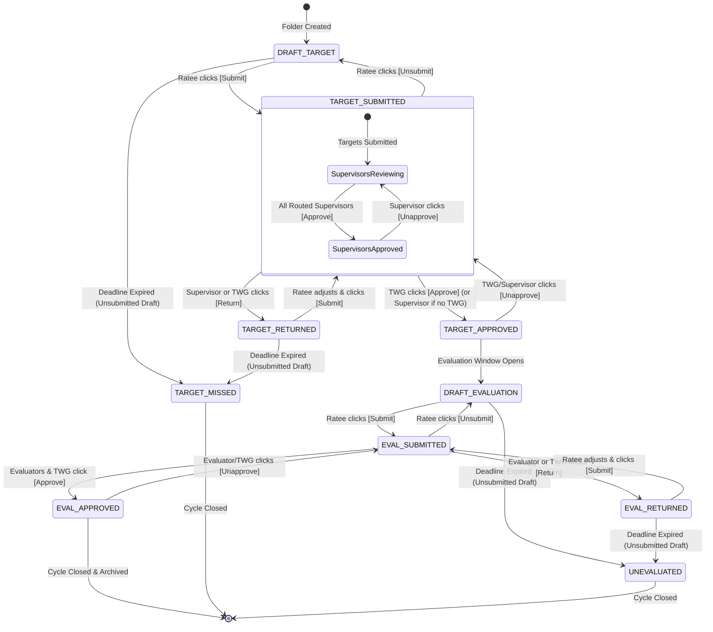

# SPMS 3-Layer Status System Architecture

This document defines the unified 3-layer status architecture implemented across the Strategic Performance Management System (SPMS). It details the lifecycle state machine, the visual presentation standards across user touchpoints, and the design rationale governing the naming conventions.

---

## 1. Executive Summary & Design Principles

The SPMS performance evaluation cycle follows two distinct administrative phases mandated by the Civil Service Commission (CSC):
1. **Phase 1: Target Setting & Commitment Formulation** (beginning of semester/year).
2. **Phase 2: Accomplishment Reporting & Performance Evaluation** (end of semester/year).

Prior to this architecture, status strings were fragmented across legacy values (`to evaluate`, `draft`, `target_unapproved`, `reevaluate`, `twg_approved`, `twg_disapproved`, `pending_target_approval`), leading to inconsistent database states, UI collisions, and confusing button labels (e.g. "Revoke Self-Rating").

The 3-layer architecture resolves this by strictly decoupling:
- **Layer 1: Global Lifecycle State Machine** (Database key & folder identity).
- **Layer 2: Review Authority Hub** (Multi-supervisor & TWG verification cards).
- **Layer 3: Workspace Action Controls** (Minimalist action buttons in the Document Editor navbar).

---

## 2. Layer 1: Master Lifecycle & Folder Status Machine

Layer 1 operates at the **Folder Level** and is persisted in `document_folders.status`. It is backed by the PHP enum [`App\Enums\FolderStatus`](file:///home/ubuntu/server/html/SPMS-capstone/app/Enums/FolderStatus.php).

### Canonical Status Roster (10 States)

| Phase | Canonical Status Key | UI Badge Text | Badge Styling | Description |
|---|---|---|---|---|
| **Phase 1: Targets** | `draft_target` | `DRAFT TARGET` | Neutral Slate | Ratee is drafting performance commitments. Not yet submitted to evaluators. |
| **Phase 1: Targets** | `target_submitted` | `TARGET SUBMITTED` | Amber Pulsing / Sky | Ratee submitted targets. Stays in this state until all supervising authorities and the TWG complete their reviews. |
| **Phase 1: Targets** | `target_returned` | `TARGET RETURNED` | Rose / Revision | A reviewer or TWG returned targets with revision comments. |
| **Phase 1: Targets** | `target_approved` | `TARGET APPROVED` | Emerald / Success | Final approval granted by the TWG (or supervising authority if no TWG assigned). Targets are locked for the semester. |
| **Phase 1: Targets** | `target_missed` | `MISSED DEADLINE` | Rose / Danger | Employee failed to submit target commitments before the target window deadline closed. |
| **Phase 2: Evaluation** | `draft_evaluation` | `DRAFT EVALUATION` | Neutral Slate | Evaluation window is open. Ratee is drafting self-ratings, actual accomplishments, and MOVs. |
| **Phase 2: Evaluation** | `eval_submitted` | `EVALUATION SUBMITTED` | Amber Pulsing / Sky | Ratee locked self-ratings and submitted accomplishments for evaluation review. |
| **Phase 2: Evaluation** | `eval_returned` | `EVALUATION RETURNED` | Rose / Revision | Reviewer or TWG returned evaluation for adjustment or additional MOVs. |
| **Phase 2: Evaluation** | `eval_approved` | `EVALUATION APPROVED` | Emerald / Success | Final numerical rating is calibrated and formally approved by all authorities. Cycle completed. |
| **Phase 2: Evaluation** | `unevaluated` | `MISSED DEADLINE` | Rose / Danger | Employee failed to submit accomplishments before the evaluation window deadline closed. |

> [!NOTE]
> **Separation of Concerns: Layer 1 Generalism vs Layer 2 Specificity**
> 
> Layer 1 is intentionally high-level and general (`TARGET SUBMITTED`). It does not leak reviewer counts or intermediate sub-states (such as "Partially Approved" or "Supervisors Approved") into the master lifecycle badge.
> 
> All granular progress—who has approved, who has not, and whether TWG verification is awaiting supervisor sign-off—is handled strictly within **Layer 2** via the Supervising Authorities & TWG Card Hub.

### Cycle Progress Tracker (Stepper Mapping)

The Cycle Progress Tracker on the folder dashboard is directly computed via `FolderStatus::stepperIndex()`:

```
[ Step 1: Target Setting ] ──▶ [ Step 2: Target Approved ] ──▶ [ Step 3: Evaluation Phase ] ──▶ [ Step 4: Final Rating ]
  • draft_target                  • target_approved              • draft_evaluation               • eval_approved
  • target_submitted                                             • eval_submitted
  • target_returned                                              • eval_returned
  • target_missed                                                • unevaluated
```

### Why Layer 1 Statuses Are Globally Unique Identifiers

> [!IMPORTANT]
> **Design Decision Rationale: Global Lifecycle Uniqueness**
> 
> Layer 1 statuses use fully qualified prefixes (e.g., `target_approved` vs `eval_approved`, `draft_target` vs `draft_evaluation`, `target_missed` vs `unevaluated`) rather than generic words like `draft` or `approved`.
> 
> 1. **Single Source of Truth**: `document_folders.status` serves as the primary state machine key. A query such as `WHERE status = 'target_approved'` returns only folders ready for target cascading or waiting for the evaluation window, without accidentally including completed evaluations.
> 2. **Phase Determination Without Timestamp Ambiguity**: System workers, deadline daemons, cascade validators, and reporting controllers can instantly determine whether a folder is in Phase 1 or Phase 2 simply by checking the status string, without needing complex date-range comparisons:
>    ```php
>    $cStatus = \App\Enums\FolderStatus::canonical($folder['status']);
>    if ($cStatus->isTargetPhase()) {
>        // Target Setting logic (commitments, target routing, rubrics, target cascading)
>    } else {
>        // Accomplishment & Evaluation logic (ratings, MOVs, evaluators, final calibration)
>    }
>    ```
> 3. **Database Integrity & Indexing**: Database indexing on `document_folders.status` allows rapid partitioning in reports, executive leaderboards, and compliance matrices.

---

## 3. Layer 2: Review Authorities & Evaluator Card Hub

Layer 2 operates at the **Evaluator/Reviewer Level** and is persisted in `evaluation_routings.status` (with visual representations in the Folder Hub cards in [`app/Views/document/_doc_rows.php`](file:///home/ubuntu/server/html/SPMS-capstone/app/Views/document/_doc_rows.php)).

### Card Status Pills & States

In the Folder Hub, reviewers (Immediate Supervisors, Division Chiefs, Deans, University President) and compliance authorities (TWG / PMT) appear in two dedicated tabs:
- **Tab 1: Target Setting Phase**
- **Tab 2: Evaluation Phase**

Within each tab, every authority card displays its exact verification state:

| Evaluator State Key | Display Label (Supervisor) | Display Label (TWG / PMT) | Visual Style | Condition |
|---|---|---|---|---|
| `pending` | `Pending Review` | `Pending Verification` | Amber Pill + Pulsing Dot | Document submitted; reviewer action required. |
| `approved` | `Approved` | `Approved` | Emerald Pill + Checkmark | Authority approved the phase submission. |
| `returned` | `Returned` | `Returned` | Rose Pill + Return Icon | Authority returned submission for revision. |

### Why Layer 2 Statuses Share Common Verbs

> [!NOTE]
> **Design Decision Rationale: Contextual Symmetry**
> 
> Unlike Layer 1, Layer 2 statuses in `evaluation_routings.status` strictly use shared, normalized verbs (`pending`, `approved`, `returned`).
> 
> 1. **Context is Already Qualified**: The evaluator routing row is already scoped to a specific `folder_id`, an evaluator `user_id`, and a phase tab context. Having `target_approved` on an evaluator row would be redundant when the evaluator is already inside the "Target Setting Phase" container.
> 2. **Symmetrical Consensus Logic**: The folder consensus checker (`updateFolderConsensus()`) can run clean SQL aggregations (`COUNT(*) WHERE status = 'approved'`) regardless of whether it is evaluating targets or final ratings.
> 3. **Unified Reviewer Mental Model**: A supervisor or TWG member always performs one of two core actions: **Approve** or **Return**. Sharing status verbs reflects this unified responsibility.

---

## 4. Layer 3: Workspace Action Controls (Document Editor Navbar)

Layer 3 operates in the top navigation bar of the Document Editor ([`app/Views/document/show.php`](file:///home/ubuntu/server/html/SPMS-capstone/app/Views/document/show.php)).

### Minimalist Action Philosophy

The document editor is a high-density authoring sheet. Cluttering the navbar with bulky status tags (e.g. `[Awaiting Target Approval]`, `[You Approved Targets...]`, `[Waiting for Employee]`) created visual fatigue and duplicated information already prominently visible in the Folder Hub.

Layer 3 adheres to **strict verb minimalism**:

#### 1. Ratee Controls (Employee)
- **`[Submit]`** (`#btn-submit`, `#btn-submit-target`): Appears when commitments/ratings are in `draft_target`, `draft_evaluation`, or returned for revision. Saves and submits the document.
- **`[Unsubmit]`** (`#btn-unsubmit-target`, `#btn-unsubmit-eval`): Replaces bulky "Revoke" buttons. Allows the ratee to withdraw their submission back to draft before any supervisor approves it.

#### 2. Reviewer Controls (Supervisors & Deans)
- **`[Approve]`** (`#btn-approve`, `#btn-approve-target`): Advances the reviewer's routing to `approved`.
- **`[Return]`** (`#btn-return`, `#btn-return-target`): Opens remark prompt to return the document for revision.
- **`[Unapprove]`** (`#btn-unapprove-target`, `#btn-unapprove-evaluation`): Allows a reviewer to roll back an approval if the deadline window is still active.

#### 3. Compliance Authority Controls (TWG / PMT)
- **Gated Review Pipeline**: TWG review controls are strictly locked with an `Awaiting Supervising Authorities' Approval` badge until all routed supervising authorities (e.g., Immediate Supervisor, Dean, VPAA) have completed their target review.
- **`[Approve]`** (`#btn-approve-target`): Acts as the **final approver** for target commitments. Once TWG approves, the document officially reaches `TARGET APPROVED` (`target_approver_role = 'TWG'`).
- **`[Return]`** (`#btn-return-target`): Returns targets to the employee for revision with feedback remarks.
- **`[Unapprove]`** (`#btn-unapprove-target`): Reverts the document back to `TARGET_SUBMITTED` (`Pending Verification`).
- **Evaluation Phase Controls**: In Phase 2, TWG utilizes `[Approve]` (`#btn-twg-approve`), `[Return]` (`#btn-twg-disapprove`), and `[Unapprove]` (`#btn-twg-revoke`).

#### 4. Read-Only Deadline State
- **`Missed Deadline`**: If the phase ended with no submission, a clean badge replaces action buttons.

---

## 5. Lifecycle State Machine Diagram



---

## 6. Deadline Immunity & Safety Architecture

> [!TIP]
> **Safety Rule: Ratees Who Submit On Time Never Incur Missed Deadlines**
> 
> A critical safeguard built into the SPMS background worker ([`NightlyWorker.php`](file:///home/ubuntu/server/html/SPMS-capstone/app/Commands/NightlyWorker.php#L34)) and model guards ([`DocumentFolderModel.php`](file:///home/ubuntu/server/html/SPMS-capstone/app/Models/DocumentFolderModel.php#L310)) is:
> 
> ```sql
> -- Only unsubmitted draft folders are transitioned to missed:
> UPDATE document_folders 
> SET status = 'target_missed' 
> WHERE status = 'draft_target' 
>   AND target_date_end < NOW();
> ```
> 
> - **Submitted Folders are Immune**: If a ratee submitted on time (`target_submitted` or `eval_submitted`), the folder is **never** flagged as missed, even if the deadline passes while supervisors or TWG reviewers are still conducting reviews.
> - **Reviewers Retain Authority**: Supervisors and TWG members can continue to review, verify, approve, or return submitted documents after the ratee deadline has elapsed without locking out the employee or corrupting evaluation consensus.

---

## 7. Implementation Map

| File | Role in Status Architecture |
|---|---|
| [`app/Enums/FolderStatus.php`](file:///home/ubuntu/server/html/SPMS-capstone/app/Enums/FolderStatus.php) | Central canonical status definition, legacy string normalizer, stepper index calculator, and phase helpers. |
| [`app/Models/DocumentFolderModel.php`](file:///home/ubuntu/server/html/SPMS-capstone/app/Models/DocumentFolderModel.php) | Automatic deadline transitions (`target_missed`, `unevaluated`), folder lock guards, and status queries. |
| [`app/Models/TwgUnitAssignmentModel.php`](file:///home/ubuntu/server/html/SPMS-capstone/app/Models/TwgUnitAssignmentModel.php) | Unit-level and collegiate TWG reviewer assignment resolution and folder routing checks. |
| [`app/Controllers/Folder.php`](file:///home/ubuntu/server/html/SPMS-capstone/app/Controllers/Folder.php) | Lifecycle endpoints (`submitTarget`, `unsubmitTarget`, `approveTarget`, `returnTarget`, `evaluate`, `unsubmit`, `approve`, `returnRevision`, `twgApprove`). Enforces sequential supervisor -> TWG target approval pipeline. |
| [`app/Controllers/Rating.php`](file:///home/ubuntu/server/html/SPMS-capstone/app/Controllers/Rating.php) | Queue partitioning and bucket filtering for supervisor review queues using canonical statuses. |
| [`app/Controllers/Dashboard.php`](file:///home/ubuntu/server/html/SPMS-capstone/app/Controllers/Dashboard.php) | Executive overview, compliance percentages, revision counters, and subordinate roster tags. |
| [`app/Controllers/Attachment.php`](file:///home/ubuntu/server/html/SPMS-capstone/app/Controllers/Attachment.php) | Rubric (Phase 1) vs MOV (Phase 2) upload permission enforcement based on canonical phase. |
| [`app/Controllers/Document.php`](file:///home/ubuntu/server/html/SPMS-capstone/app/Controllers/Document.php) | Privacy guards preventing evaluators from viewing unsubmitted drafts, superior basis validation, and supervisor consensus check (`allSupervisorsApproved`). |
| [`app/Views/document/_doc_rows.php`](file:///home/ubuntu/server/html/SPMS-capstone/app/Views/document/_doc_rows.php) | Layer 1 Stepper & Hub badges, and Layer 2 Supervisor/TWG cards with clean status pills (`Pending Review`, `Pending Verification`, `Approved`, `Returned`). |
| [`app/Views/document/show.php`](file:///home/ubuntu/server/html/SPMS-capstone/app/Views/document/show.php) | Layer 3 Document Editor navbar with minimal action buttons (`Submit`, `Unsubmit`, `Approve`, `Return`, `Unapprove`), and TWG review gating badge. |
| [`app/Views/ratings/index.php`](file:///home/ubuntu/server/html/SPMS-capstone/app/Views/ratings/index.php) | Review queue tables with standardized canonical color badges and labels. |
