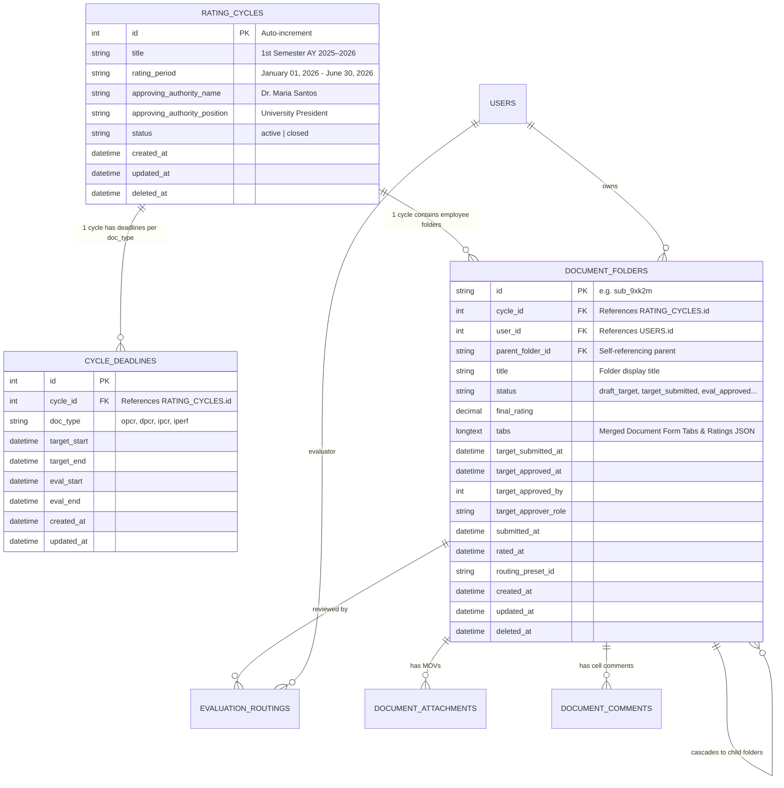

# SPMS Unified Schema & Data Architecture Specification

## 1. Overview & Objectives
This document specifies the unified database architecture, baseline data models, and entity relationships for the Benguet State University Strategic Performance Management System (BSU-SPMS).

### Core Architectural Principles:
1. **Dedicated Rating Cycle Entity**:
   - `rating_cycles` table stores cycle titles, rating periods, president/approving authority metadata, and macro operational status (`active`, `closed`).
   - `cycle_deadlines` references `rating_cycles.id`, storing start dates and staggered end dates per `doc_type` (`opcr`, `dpcr`, `ipcr`, `iperf`).
2. **Unified Document-Folder Schema**:
   - Evaluation forms, commitments, performance targets, categories, rubrics, and actual accomplishments are stored directly in `document_folders.tabs` as structured JSON.
   - The database does not use separate `documents` or `templates` tables.
3. **Clean Baseline Migrations**:
   - Canonical baseline migrations define all tables and foreign keys without temporary patching migrations.
4. **Realistic Organizational Hierarchy**:
   - An organizational structure spanning Academic Affairs (VPAA: Deans -> Chairs -> Faculty) and Administration/Finance (VPAF: Unit Heads -> Staff / IPERF).
   - Standard development password for seeded test accounts is `123`.

---

## 2. Entity Relationship Diagram

---

## 3. Seeded Organizational Hierarchy (VPAA & VPAF)

| Email | Name | Role | Position | Unit | Doc Type | Parent / Supervisor |
|---|---|---|---|---|---|---|
| **admin@test.com** | System Admin | Admin | University President | Office of the President | None | Apex Evaluator |
| **twg@test.com** | System TWG | TWG | TWG Reviewer | Quality Assurance | None | Compliance Reviewer |
| **pmt@test.com** | PMT Chair | PMT | PMT Committee Chair | Planning & Development | None | Appeals & Calibration |
| **vpaa@test.com** | Dr. Ana Santos | Supervisor | Vice President for Academic Affairs | OVPAA | OPCR | President (admin) |
| **vpaf@test.com** | Engr. Roberto Mendoza | Supervisor | Vice President for Admin & Finance | OVPAF | OPCR | President (admin) |
| **dean.cis@test.com** | Dr. Alexander Mercado | Supervisor | College Dean | College of Information Sciences | DPCR | VPAA |
| **chair.cis@test.com** | Clarissa Diaz | Supervisor | Department Chair | BS Information Technology | DPCR | Dean CIS |
| **faculty.cis1@test.com** | Kenji Tanaka | Employee | Assistant Professor | BS Information Technology | IPCR | Chair CIS |
| **faculty.cis2@test.com** | Stephanie Reyes | Employee | Instructor II | BS Information Technology | IPCR | Chair CIS |
| **dean.cn@test.com** | Dr. Roberto Reyes | Supervisor | College Dean | College of Nursing | DPCR | VPAA |
| **chair.cn@test.com** | Miguel Cruz | Supervisor | Department Chair | BS Nursing | DPCR | Dean CN |
| **faculty.cn1@test.com** | Carlos Lim | Employee | Assistant Professor | BS Nursing | IPCR | Chair CN |
| **faculty.cn2@test.com** | Teresa Garcia | Employee | Instructor I | BS Nursing | IPCR | Chair CN |
| **dean.ca@test.com** | Dr. Bernardo Ocampo | Supervisor | College Dean | College of Agriculture | DPCR | VPAA |
| **chair.ca@test.com** | Corazon Villanueva | Supervisor | Department Chair | BS Agriculture | DPCR | Dean CA |
| **faculty.ca1@test.com** | Ferdinand Aquino | Employee | Professor | BS Agriculture | IPCR | Chair CA |
| **head.gso@test.com** | Rodrigo Estrada | Supervisor | Unit Head / Chief | General Services Office | DPCR | VPAF |
| **staff.gso1@test.com** | Nestor Pascual | Employee | Administrative Aide | General Services Office | IPERF | Head GSO |
| **staff.gso2@test.com** | Leonora Villar | Employee | Administrative Assistant | General Services Office | IPERF | Head GSO |
| **head.hrmo@test.com** | Maria Clara Cruz | Supervisor | Unit Head / HR Chief | Human Resource Management | DPCR | VPAF |
| **staff.hrmo1@test.com** | Danilo Santos | Employee | Administrative Assistant | Human Resource Management | IPERF | Head HRMO |
| **head.acc@test.com** | Carmen Perez | Supervisor | Chief Accountant | Accounting Office | DPCR | VPAF |
| **staff.acc1@test.com** | Mark Joseph Bautista | Employee | Bookkeeper | Accounting Office | IPERF | Head Accounting |
